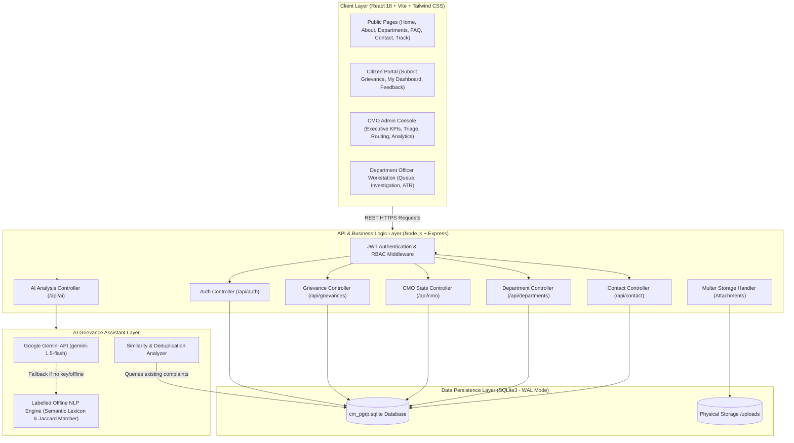

# CM-PGRP Kerala: System Architecture
**Chief Minister's Public Grievance Redressal Portal**
*Technical Architecture, Component Design & Interaction Flows*

---

## 1. High-Level Architectural Diagram

The CM-PGRP platform uses a modern, modular 3-tier architecture with an integrated asynchronous AI Service Layer:

---

## 2. Frontend Layer Design (`client/`)
The frontend is constructed as a responsive Single Page Application (SPA) adhering to modern Kerala Government visual standards (official state green `#056839`, clean navy `#0f172a`, and saffron/gold accents `#f59e0b`).

- **Core Framework:** React 18 with Vite bundling for sub-second hot reloading and optimized production bundles.
- **Styling:** Tailwind CSS with custom government-grade palettes and typography (`Plus Jakarta Sans` for English and `Manjari` for Malayalam script elements).
- **Navigation & Routing:** `react-router-dom` v7 with nested layouts, parameter-driven deep linking (e.g. `/track?ref=KL-CMO-2026-00101` and `/citizen/submit?dept=1`), and strict `ProtectedRoute` guards.
- **State Management:**
  - `AuthContext`: Centralized JWT authentication state, token persistence in `localStorage`, user role scopes, and automatic token expiration interceptors.
  - Component State: Optimized React Hooks (`useState`, `useEffect`, `useMemo`) ensuring fast UI rendering without extraneous dependencies.
- **Iconography:** `lucide-react` for clean, lightweight, accessible UI icons.

---

## 3. Backend Layer Design (`server/`)
The backend is structured using a clean Controller-Service-Repository architecture in Node.js and Express:

### 3.1 Middleware Pipeline
1. **CORS Middleware:** Configured with explicit origin allowances, REST method restrictions, and allowed headers.
2. **Body Parsers:** Native Express JSON and URL-encoded parsers with safety payload limits (50MB).
3. **HTTP Logger:** `morgan` structured logging in development and production formats.
4. **Static Attachment Server:** Express static handler serving `/uploads` with strict path isolation.
5. **Auth & RBAC Middleware (`middleware/auth.js`):**
   - `verifyToken`: Validates incoming Bearer JWT tokens against the cryptographic secret and verifies active existence in the database.
   - `requireRoles(...roles)`: Enforces role checks (`citizen`, `cmo_admin`, `officer`).
   - `optionalToken`: Facilitates frictionless public tracking while preserving user identity for logged-in sessions.
6. **Unified Client Serving:** In production, Express automatically hosts the built single-page client (`client/dist`), enabling zero-configuration single-port deployments on cloud hosts like Render or Railway.

---

## 4. Database Persistence Layer
The application utilizes an embedded, high-performance SQLite engine powered by `better-sqlite3`:
- **ACID Compliant:** Full transactional integrity across multi-entity operations (e.g. inserting grievance + writing initial audit history + recording attachment).
- **Zero-Configuration:** Stored in a single file (`server/data/cm_pgrp.sqlite`), allowing instant evaluation on Windows, Linux, and macOS without requiring external service installations.
- **High Concurrency:** Configured with `PRAGMA journal_mode = WAL;` (Write-Ahead Logging) and `PRAGMA foreign_keys = ON;`.
- **Relational Integrity:** Explicit foreign keys with cascading deletes on child relations (`ON DELETE CASCADE` for attachments, history, feedback).
- **Indices:** High-speed lookup indices on `reference_id`, `citizen_id`, `department_id`, `status`, and `district`.

---

## 5. AI Grievance Assistant Service Layer (`services/aiService.js`)
The AI module operates with dual-engine flexibility:
1. **Cloud LLM (Google Gemini API):** When `GEMINI_API_KEY` is provided, petitions are analyzed by `gemini-1.5-flash` with a strict JSON schema enforcing department codes, category classifications, SLA urgency factors, and executive summaries.
2. **Labelled Offline NLP Fallback Engine:** If the API key is not supplied or if internet connectivity is absent, the system activates the labelled offline NLP analyzer:
   - Evaluates text using tokenization, stopword filtering, and weighted domain lexicons across all 10 departments.
   - Detects life-threatening public hazards (e.g., sparking transformers, pipe bursts, hospital medicine stockouts) to assign High priority.
   - Computes Jaccard/cosine token overlap against recent grievances in the same district to alert administrators of potential duplicate complaints.
3. **Ethical Safeguard (Human-in-the-Loop):** AI outputs serve as recommendations only; official department assignment and status transitions are explicitly authorized by citizens or CMO administrators.

---

## 6. Security & Data Protection Controls
- **Password Protection:** Cryptographic password hashing using `bcryptjs` with 10 salt rounds.
- **Session Tokens:** Cryptographically signed JSON Web Tokens (JWT) with 7-day expiration.
- **File Upload Protection:** Whitelist validation of MIME types (`image/jpeg`, `image/png`, `application/pdf`, `application/msword`) and a 15MB file-size ceiling.
- **SQL Injection Prevention:** 100% parameterized queries across all database operations using prepared statements (`db.prepare(...)`).
