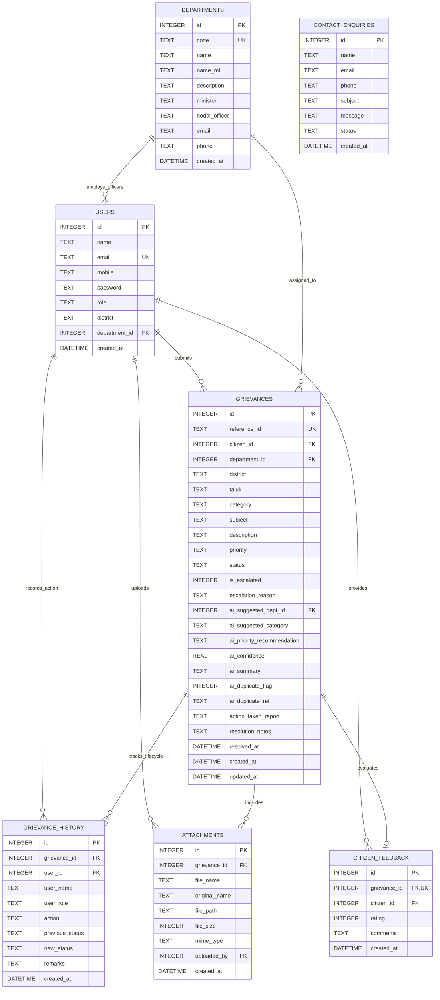

# CM-PGRP Kerala: Database Design & Schema
**Chief Minister's Public Grievance Redressal Portal**
*Relational Data Model, Entities, Constraints, and Indexing Strategy*

---

## 1. Database Entity-Relationship (ER) Diagram



---

## 2. Detailed Table Specifications & Data Dictionary

### 2.1 `departments` Table
Stores official state government department profiles participating in the CM-PGRP initiative.

| Column | Data Type | Constraints | Description |
| :--- | :--- | :--- | :--- |
| `id` | `INTEGER` | PRIMARY KEY AUTOINCREMENT | Unique departmental identifier. |
| `code` | `TEXT` | UNIQUE NOT NULL | Abbreviated code (e.g. `PWD`, `KWA`, `KSEB`, `HEALTH`). |
| `name` | `TEXT` | NOT NULL | Official English department title. |
| `name_ml` | `TEXT` | NOT NULL | Official Malayalam department script title. |
| `description` | `TEXT` | NOT NULL | Jurisdictional scope and responsibilities. |
| `minister` | `TEXT` | NULLABLE | Cabinet minister holding the portfolio. |
| `nodal_officer`| `TEXT` | NULLABLE | State chief/nodal officer in charge of redressal. |
| `email` | `TEXT` | NULLABLE | Official nodal grievance email address. |
| `phone` | `TEXT` | NULLABLE | Department emergency / inquiry phone number. |
| `created_at` | `DATETIME` | DEFAULT CURRENT_TIMESTAMP | Record creation timestamp. |

---

### 2.2 `users` Table
Stores registered citizens, CMO administrators, and department nodal officers.

| Column | Data Type | Constraints | Description |
| :--- | :--- | :--- | :--- |
| `id` | `INTEGER` | PRIMARY KEY AUTOINCREMENT | Unique user account identifier. |
| `name` | `TEXT` | NOT NULL | Full name of the user or officer. |
| `email` | `TEXT` | UNIQUE NOT NULL | Official or personal email address (login username). |
| `mobile` | `TEXT` | NOT NULL | 10-digit mobile number for SMS/notifications. |
| `password` | `TEXT` | NOT NULL | Cryptographic hash (Bcrypt, 10 rounds). |
| `role` | `TEXT` | NOT NULL CHECK (role IN ('citizen', 'cmo_admin', 'officer')) | Role determining system access privileges. |
| `district` | `TEXT` | NULLABLE | Residential district (for citizens) or posting district. |
| `department_id`| `INTEGER` | FOREIGN KEY REFERENCES `departments(id)` | Assigned department (for `officer` role). |
| `created_at` | `DATETIME` | DEFAULT CURRENT_TIMESTAMP | Account registration timestamp. |

---

### 2.3 `grievances` Table
Core transactional entity representing public complaints submitted by citizens.

| Column | Data Type | Constraints | Description |
| :--- | :--- | :--- | :--- |
| `id` | `INTEGER` | PRIMARY KEY AUTOINCREMENT | Internal primary key. |
| `reference_id` | `TEXT` | UNIQUE NOT NULL | Public tracking ID (`KL-CMO-YYYY-XXXXX`). |
| `citizen_id` | `INTEGER` | FOREIGN KEY REFERENCES `users(id)` ON DELETE CASCADE | Filing citizen identifier. |
| `department_id`| `INTEGER` | FOREIGN KEY REFERENCES `departments(id)` ON DELETE SET NULL | Assigned department. |
| `district` | `TEXT` | NOT NULL | Kerala district where the issue exists (1 of 14). |
| `taluk` | `TEXT` | NULLABLE | Taluk / local body / village locality. |
| `category` | `TEXT` | NOT NULL | Grievance categorization (e.g. `Pothole Repair`). |
| `subject` | `TEXT` | NOT NULL | Brief summary line of the complaint. |
| `description` | `TEXT` | NOT NULL | Full descriptive narrative provided by the citizen. |
| `priority` | `TEXT` | CHECK IN ('Low', 'Medium', 'High') DEFAULT 'Medium' | Operational urgency level. |
| `status` | `TEXT` | CHECK IN ('Submitted', 'Under Review', 'In Progress', 'Resolved', 'Reopened') | Current lifecycle state. |
| `is_escalated` | `INTEGER` | DEFAULT 0 | 1 if escalated by CMO, 0 otherwise. |
| `escalation_reason`| `TEXT` | NULLABLE | Justification notes for escalation. |
| `ai_suggested_dept_id`| `INTEGER` | FOREIGN KEY REFERENCES `departments(id)` | AI-recommended department. |
| `ai_suggested_category`| `TEXT` | NULLABLE | AI-suggested category classification. |
| `ai_priority_recommendation`| `TEXT` | NULLABLE | AI-recommended urgency priority. |
| `ai_confidence`| `REAL` | DEFAULT 0.0 | Confidence score (0.0 to 1.0) of AI prediction. |
| `ai_summary` | `TEXT` | NULLABLE | AI-generated executive summary for CMO. |
| `ai_duplicate_flag`| `INTEGER` | DEFAULT 0 | 1 if similar complaint exists in locality. |
| `ai_duplicate_ref`| `TEXT` | NULLABLE | Reference ID of matched potential duplicate. |
| `action_taken_report`| `TEXT` | NULLABLE | Official report filed by department officer upon completion. |
| `resolution_notes`| `TEXT` | NULLABLE | Final administrative closing remarks. |
| `resolved_at` | `DATETIME` | NULLABLE | Timestamp when marked `Resolved`. |
| `created_at` | `DATETIME` | DEFAULT CURRENT_TIMESTAMP | Submission timestamp. |
| `updated_at` | `DATETIME` | DEFAULT CURRENT_TIMESTAMP | Last modification timestamp. |

---

### 2.4 `grievance_history` Table
Immutable audit trail capturing every milestone and status transition.

| Column | Data Type | Constraints | Description |
| :--- | :--- | :--- | :--- |
| `id` | `INTEGER` | PRIMARY KEY AUTOINCREMENT | Unique history record identifier. |
| `grievance_id` | `INTEGER` | FOREIGN KEY REFERENCES `grievances(id)` ON DELETE CASCADE | Associated grievance. |
| `user_id` | `INTEGER` | FOREIGN KEY REFERENCES `users(id)` ON DELETE SET NULL | Official or citizen who triggered action. |
| `user_name` | `TEXT` | NOT NULL | Snapshot of user name at action time. |
| `user_role` | `TEXT` | NOT NULL | Role of the responsible actor. |
| `action` | `TEXT` | NOT NULL | Action code (`SUBMITTED`, `CMO_REVIEW`, `FORWARDED_TO_DEPT`, etc.). |
| `previous_status`| `TEXT` | NULLABLE | Status before the transition. |
| `new_status` | `TEXT` | NULLABLE | Status resulting from the transition. |
| `remarks` | `TEXT` | NULLABLE | Detailed comments, instructions, or findings. |
| `created_at` | `DATETIME` | DEFAULT CURRENT_TIMESTAMP | Exact action timestamp. |

---

### 2.5 `attachments` Table
Metadata for supporting documents and photos uploaded by citizens or officers.

| Column | Data Type | Constraints | Description |
| :--- | :--- | :--- | :--- |
| `id` | `INTEGER` | PRIMARY KEY AUTOINCREMENT | Unique attachment identifier. |
| `grievance_id` | `INTEGER` | FOREIGN KEY REFERENCES `grievances(id)` ON DELETE CASCADE | Associated grievance. |
| `file_name` | `TEXT` | NOT NULL | Sanitized unique storage filename on disk. |
| `original_name`| `TEXT` | NOT NULL | Original filename uploaded by the user. |
| `file_path` | `TEXT` | NOT NULL | Web-accessible URL path (`/uploads/...`). |
| `file_size` | `INTEGER` | NOT NULL | File size in bytes. |
| `mime_type` | `TEXT` | NOT NULL | MIME type (e.g. `image/jpeg`, `application/pdf`). |
| `uploaded_by` | `INTEGER` | FOREIGN KEY REFERENCES `users(id)` | User who uploaded the attachment. |
| `created_at` | `DATETIME` | DEFAULT CURRENT_TIMESTAMP | Upload timestamp. |

---

### 2.6 `citizen_feedback` Table
Citizen satisfaction ratings and verification remarks upon grievance resolution.

| Column | Data Type | Constraints | Description |
| :--- | :--- | :--- | :--- |
| `id` | `INTEGER` | PRIMARY KEY AUTOINCREMENT | Unique feedback identifier. |
| `grievance_id` | `INTEGER` | UNIQUE FOREIGN KEY REFERENCES `grievances(id)` ON DELETE CASCADE | Associated resolved grievance. |
| `citizen_id` | `INTEGER` | FOREIGN KEY REFERENCES `users(id)` ON DELETE CASCADE | Filing citizen. |
| `rating` | `INTEGER` | CHECK (rating >= 1 AND rating <= 5) | Satisfaction rating (1 to 5 stars). |
| `comments` | `TEXT` | NULLABLE | Citizen's qualitative feedback commentary. |
| `created_at` | `DATETIME` | DEFAULT CURRENT_TIMESTAMP | Feedback submission timestamp. |

---

### 2.7 `contact_enquiries` Table
Stores general public inquiries submitted via the portal's Contact Us page.

| Column | Data Type | Constraints | Description |
| :--- | :--- | :--- | :--- |
| `id` | `INTEGER` | PRIMARY KEY AUTOINCREMENT | Unique enquiry identifier. |
| `name` | `TEXT` | NOT NULL | Inquiring citizen's name. |
| `email` | `TEXT` | NOT NULL | Email address for reply. |
| `phone` | `TEXT` | NULLABLE | Optional telephone contact. |
| `subject` | `TEXT` | NOT NULL | Subject line of the query. |
| `message` | `TEXT` | NOT NULL | Query details. |
| `status` | `TEXT` | CHECK IN ('New', 'Read', 'Replied') DEFAULT 'New' | Processing status. |
| `created_at` | `DATETIME` | DEFAULT CURRENT_TIMESTAMP | Submission timestamp. |

---

## 3. High-Performance Indexing Strategy
To guarantee fast query times even under thousands of active records, the following composite and single-column indices are implemented:
```sql
CREATE INDEX idx_grievances_ref ON grievances(reference_id);
CREATE INDEX idx_grievances_citizen ON grievances(citizen_id);
CREATE INDEX idx_grievances_dept ON grievances(department_id);
CREATE INDEX idx_grievances_status ON grievances(status);
CREATE INDEX idx_grievances_district ON grievances(district);
CREATE INDEX idx_grievance_history_gid ON grievance_history(grievance_id);
```
