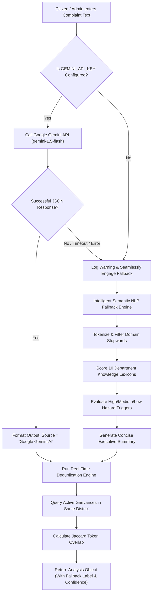

# CM-PGRP Kerala: AI Grievance Assistant Specification
**Chief Minister's Public Grievance Redressal Portal**
*AI Architecture, Prompt Engineering, Fallback Engineering, Safeguards & Deduplication*

---

## 1. Overview of AI Integration
In accordance with Section 6 of the assessment guidelines, the portal incorporates an **AI Grievance Assistant** to accelerate petition triage and routing while upholding the principle of **Human-in-the-Loop Governance**.

The AI Assistant is designed to assist both:
1. **The Filing Citizen:** Real-time text analysis before final submission, auto-suggesting the appropriate government department and category, estimating priority, and warning of potential duplicate complaints.
2. **The CMO Administrator:** Generating executive summaries and duplicate alerts to assist administrators in making fast, informed routing decisions.

---

## 2. Dual-Engine Architecture



---

## 3. Primary Engine: Google Gemini API

When `GEMINI_API_KEY` is provided in `.env`, the system connects to Google's `gemini-1.5-flash` model.

### 3.1 System Prompt & Instructions
```text
You are the AI Grievance Assistant for the Chief Minister's Public Grievance Redressal Portal (CM-PGRP), Government of Kerala.
Analyze the following citizen complaint and return ONLY a valid, raw JSON object (with NO markdown backticks, NO code block markers, NO commentary):

Complaint Subject: "${subject}"
District: "${district}"
Complaint Description: "${description}"

Allowed Department Codes:
- PWD: Road, bridges, culverts, drainage, street tarring
- KWA: Drinking water, pipeline leak/burst, contamination, sewage
- KSEB: Power outage, low voltage, fallen poles, live wire, electric shock hazard
- HEALTH: Hospitals, PHCs, medicine shortage, fever/dengue outbreaks, food safety
- EDUCATION: School infrastructure, midday meals, teachers, textbook shortage
- REVENUE: Land records, pattayam, encroachment, survey disputes, flood relief
- POLICE: Law & order, harassment, cyber crime, public safety, traffic
- LSGD: Panchayat/Municipality waste management, street lights, stray dogs, drains
- CIVIL_SUPPLIES: Ration cards, ration shops, food grains, overpricing
- TRANSPORT: KSRTC buses, reckless driving, driving licenses, route cancellations
```

### 3.2 Enforced JSON Output Schema
```json
{
  "departmentCode": "PWD" | "KWA" | "KSEB" | "HEALTH" | "EDUCATION" | "REVENUE" | "POLICE" | "LSGD" | "CIVIL_SUPPLIES" | "TRANSPORT",
  "category": "String category name",
  "priority": "Low" | "Medium" | "High",
  "priorityReason": "Brief explanation of why this priority was assigned",
  "confidence": 0.85 to 0.99,
  "summary": "1 to 2 crisp executive sentences summarizing key facts for CMO",
  "suggestedAction": "Recommended next step for administrative officer"
}
```

---

## 4. Labelled Intelligent Offline Fallback Engine

To guarantee 100% platform availability even when offline, running on an isolated evaluation server, or without third-party API credentials, the system features a **Labelled Intelligent NLP Fallback Engine**:

1. **Domain Knowledge Lexicon:**
   Maintains curated domain vocabularies across 10 official Kerala departments (e.g., PWD keywords: `road`, `pothole`, `bridge`, `tarring`, `highway`, `culvert`, `asphalt`, `flyover`, `divider`).
2. **Semantic Weighting:**
   Evaluates full-text tokens, n-grams, and context weights to determine the most relevant department and sub-category.
3. **Hazard & Urgency Assessment:**
   Detects safety and life-critical triggers (`danger`, `death`, `live wire`, `burst`, `accident`, `poison`, `epidemic`, `landslide`, `flooding`) to automatically assign **High Priority**. Routine service requests default to **Medium** or **Low**.
4. **Transparent Labeling:**
   Every fallback response is explicitly labelled with `source: "Intelligent NLP Engine (Labelled Fallback)"` and `isFallback: true` so the evaluator and user always know the active intelligence tier.

---

## 5. Duplicate Complaint Detection Engine
To assist the CMO in managing citizen campaigns or redundant filings regarding the same localized issue (e.g. multiple neighbors reporting the same water main burst in Pattom):

1. The engine queries recent active grievances from the database in the same district.
2. It cleans text, removes regional and English stopwords, and generates distinct semantic token sets.
3. It evaluates the **Jaccard Similarity Coefficient**:
   $$\text{Similarity}(A, B) = \frac{|A \cap B|}{|A \cup B|}$$
4. If similarity exceeds $0.45$ ($45\%$), the engine flags:
   - `isDuplicate: true`
   - `similarityScore: XX%`
   - `matchedRef: "KL-CMO-2026-XXXXX"`
5. This alert appears on both the citizen preview and the CMO desk for human deduplication review.

---

## 6. Ethical Safeguards & Non-Autonomous Decision Policy
As mandated by the assessment requirements:
- **No Autonomous Official Actions:** The AI engine **never** independently modifies official status, assigns budgets, or closes petitions.
- **Citizen Review & Override:** The citizen can click "Apply AI Suggestions" to populate department, category, and priority, or choose to override any recommendation manually.
- **Administrative Override:** CMO administrators can re-assign departments or modify priority at any time regardless of AI recommendations.
- **Audit Logging:** Every AI suggestion accepted by a user is logged with its confidence score for accountability.
